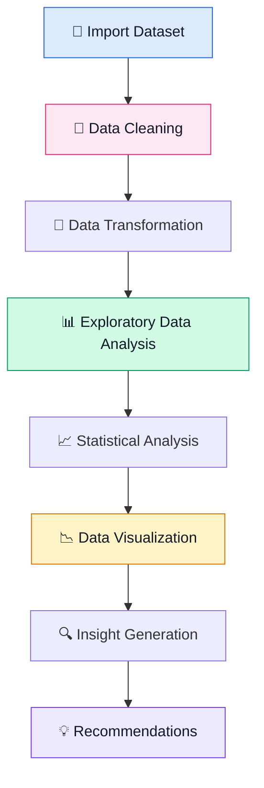
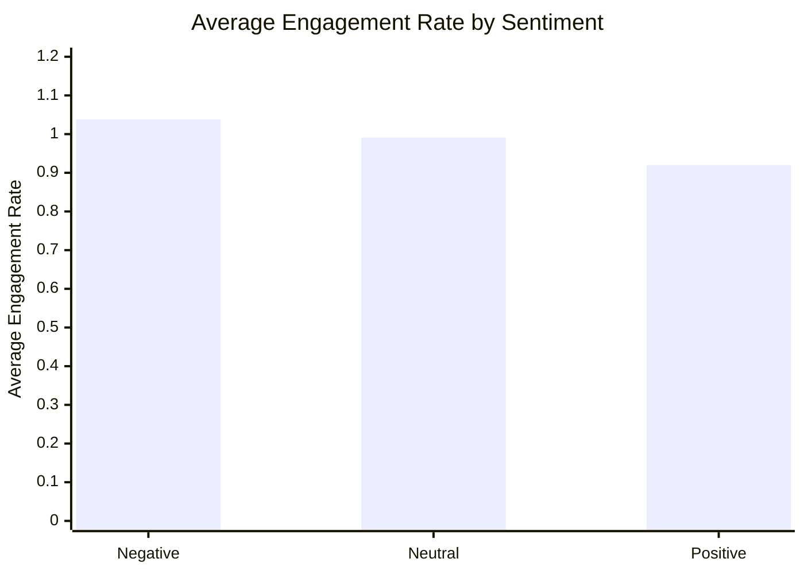

# 📊 Social Media Engagement Analytics Using Python

<p align="center">
  
  
  
  
  
</p>

<p align="center">
  <b>Turning social media data into meaningful insights and actionable recommendations.</b>
</p>

---

## 📌 Project Overview

Social media platforms generate large amounts of data through likes, comments, shares, impressions, and watch time. Understanding these metrics helps identify audience behavior, evaluate content performance, and improve engagement strategies.

This project uses **Python for Data Analysis** to explore social media engagement patterns, perform data cleaning, conduct exploratory data analysis (EDA), visualize trends, and identify insights from a dataset containing **5,000 social media records**.

## 🎯 Project Objectives

- Clean and prepare social media engagement data.
- Explore engagement metrics using Pandas and NumPy.
- Compare engagement across post types and content categories.
- Analyze audience trends across countries and age groups.
- Examine engagement differences between verified and non-verified accounts.
- Explore sentiment patterns and device-based watch time.
- Identify data quality issues and communicate findings through visualizations.

## 🛠️ Tech Stack

| Tool | Purpose |
|---|---|
| Python | Data analysis and processing |
| Pandas | Data cleaning and manipulation |
| NumPy | Numerical operations |
| Matplotlib | Data visualization |
| Seaborn | Statistical visualization |
| Plotly | Interactive visualizations |
| Jupyter Notebook | Analysis environment |

## 🔄 Project Workflow



## 📈 Key Analysis Areas

<details>
<summary><b>1. Data Cleaning & Preprocessing</b></summary>

- Identifying missing values and duplicate records.
- Handling data types and inconsistent categories.
- Checking engagement metrics for unusual or unrealistic values.
- Preparing data for statistical analysis.
- Examining potential inconsistencies in engagement-rate calculations.

</details>

<details>
<summary><b>2. Exploratory Data Analysis (EDA)</b></summary>

- Dataset structure and descriptive statistics.
- Distribution of categorical variables.
- Group-wise comparisons of engagement metrics.
- Correlation analysis between numerical variables.
- Analysis of audience and content characteristics.

</details>

<details>
<summary><b>3. Data Visualization</b></summary>

The notebook explores multiple visualization techniques, including:

- Bar charts and count plots.
- Histograms and box plots.
- Scatter plots and trend charts.
- Correlation heatmaps.
- Violin plots and other statistical visualizations.
- Interactive charts where applicable.

</details>

## 📊 Selected Findings

The following values are based on the analysis results previously obtained for this project. They should be interpreted in the context of the dataset and its data-quality limitations.

### Average Engagement Rate by Sentiment



| Sentiment | Average engagement rate |
|---|---:|
| Negative | 1.038 |
| Neutral | 0.991 |
| Positive | 0.920 |

**Observation:** Negative-sentiment posts showed the highest average engagement rate among the three sentiment groups in this dataset. This indicates engagement quantity, not necessarily positive audience response.

### Content & Audience Insights

| Analysis area | Observed result |
|---|---|
| Post type | Video posts had an average engagement rate of approximately 1.122 |
| Content category | Food had an average engagement rate of approximately 1.359 |
| Country | Brazil had an average engagement rate of approximately 1.541 |
| Age group | The 46–60 age group had an average engagement rate of approximately 1.153 |
| Account verification | Verified accounts averaged approximately 1.054, compared with 0.955 for non-verified accounts |
| Device type | Mobile users had an average watch time of approximately 4,087.83 seconds |

*Note: These are descriptive comparisons, not proof that any particular factor causes higher engagement. Confirm the figures against the final notebook outputs before publication.*

## 🔎 Data Quality & Limitations

Data quality is an important part of this project.

- Some records contain unusually high engagement rates.
- Some rows have engagement metrics that may not align with impressions.
- The engagement-rate calculation should be checked against the dataset's original definition.
- The available date field does not provide sufficient time-of-day information to reliably identify the best posting hour.

These limitations are considered when interpreting the findings.

## 📁 Repository Structure

```text
Social-Media-Engagement-Analytics/
│
├── Social_Media_Engagement_Analytics.ipynb
├── README.md
├── requirements.txt
├── .gitignore
│
└── images/
    ├── engagement_by_sentiment.png
    ├── content_performance.png
    └── correlation_heatmap.png
```

The `images/` folder is optional. Add exported charts from your notebook to display the actual analysis visuals directly in the README.

## 🚀 How to Run the Project

**1. Clone the repository**

```bash
git clone https://github.com/YOUR-USERNAME/Social-Media-Engagement-Analytics.git
```

**2. Navigate to the project folder**

```bash
cd Social-Media-Engagement-Analytics
```

**3. Install the dependencies**

```bash
pip install -r requirements.txt
```

**4. Add the dataset**

Place `social_media_engagement_5000.csv` in the project folder. Ensure you have permission to share the dataset before uploading it publicly.

**5. Open the notebook**

```bash
google colab
```

Open `Social_Media_Engagement_Analytics.ipynb` and run the cells in order.

## 💡 Key Takeaways

- Social media engagement varies across content types, categories, and audience groups.
- Sentiment and engagement should be interpreted separately.
- Visualizations help communicate patterns that are difficult to identify from raw data.
- Data validation is essential before using engagement metrics to make decisions.
- Findings can support further analysis of content strategy and audience behavior.

## 🔮 Future Improvements

- Build an interactive Power BI dashboard.
- Investigate outliers and validate engagement-rate definitions.
- Add more robust statistical comparisons.
- Explore predictive modeling for engagement.
- Develop a reusable reporting workflow.

## 👩‍💻 Author

**Gayathri S Pillai**

Aspiring Data Analyst | Python | SQL | Power BI | Data Visualization

---


  <i>“Data becomes valuable when it helps us ask better questions and make better decisions.”</i>
</p>
